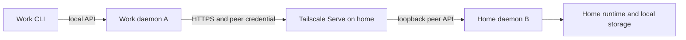

# First daemon-to-daemon integration

**Planning record, 2026-10-14; local slice now implemented.** The three delivery
steps below are implemented. The [operational guide](daemon-peering.md) records
the actual commands, route/auth boundaries, limits, and failure semantics.
Examples in this original plan remain illustrative. M1/M2 capacity and live
provider gates, plus deployed Tailscale validation, remain open.

## Findings and existing decisions

[Connectivity and sync](connectivity-sync.md), [local ownership](decisions/0002-local-ownership.md),
and [Tailscale first](decisions/0004-tailscale-first.md) already establish the
shape: each daemon owns execution locally; clients can target an owner directly
or through another daemon; Tailscale supplies initial reachability; application
pairing and authorization are still required. Aggregation and mirroring are
optional, and ownership transfer is a separate future feature.

The implementation at the start of this work had useful prerequisites:

- Durable node IDs and `owner_node_id` on conversations.
- Existing session/history/event and turn-control operations, durable command
  receipts, revision checks, and reconnectable NDJSON events.
- `slop-client` HTTP(S) transport with bounded responses, timeouts, no redirects,
  no automatic transport retries, and explicit token files.
- A loopback-only service and private local administrator token. This token
  grants broad access; it alone did not provide peer principals or scoped grants.
- Full compile-time OpenAPI coverage, including a route coverage test. New
  routes and schemas must extend that document.

Health proves protocol compatibility only. It does not authenticate the remote
machine. Peer registration, scoped authorization, and one-hop forwarding were
the missing pieces delivered in this slice. Replicated history remains future
work.

## Smallest useful outcome

A CLI at work talks to its local daemon A. A uses an explicitly registered
connection to home daemon B to inspect and steer an existing B-owned session.
B remains the only execution owner. The connection can be configured in the
opposite direction separately; granting A access to B grants no reverse access.

Deliver session listing, canonical history, event following, text steering, and
pause/resume/cancel. Keep the first target explicit with a proposed CLI selector
such as `slop --peer home session list`; this goes through the local daemon.
All command examples and route names here are illustrative.

Remote creation of tasks/projects/workspaces, cross-node agent delegation,
combined session lists, offline command queues, artifact mirroring, migration,
and automatic discovery remain subsequent slices. In particular, native child
tasks continue running on their parent's owning daemon.

## Choices and recommended defaults

| Choice | Recommended first slice | Alternative and tradeoff |
| --- | --- | --- |
| Access path | CLI -> local daemon -> explicitly selected owner | Direct CLI -> owner is smaller, but does not deliver daemon peering. |
| Transport | Tailscale Serve HTTPS -> optional dedicated loopback peer listener | Native TLS/tailnet listeners give more deployment control but add certificate and binding work. |
| Initial trust | Owner-created scoped credential, transferred privately and imported locally | A short-lived pairing-code exchange improves setup but adds another protocol and recovery flow. |
| Permissions | `read` by default; optional `read+control` | Per-session grants offer finer sharing but require more policy and filtering. |
| Delivery | One-hop requests; explicit ambiguous-delivery errors | Durable offline delivery needs expiry, revision, recovery, and queue semantics. |
| Visibility | On-demand queries for one selected peer | Aggregate views need per-owner pagination and partial-failure semantics. |

The implementation adopts these defaults. Owner provenance is carried in the
`x-slop-owner-node-id` HTTP header around unchanged DTOs; peer aliases and grant
IDs are immutable, with tombstones for outbound removal. See the operational
guide for those concrete refinements.

[Tailscale Serve](https://tailscale.com/docs/features/tailscale-serve) supports
sharing a local service over private HTTPS. Its
[examples](https://tailscale.com/docs/reference/examples/serve) cover Linux and
Windows setup. Configure it explicitly outside Slop Conductor in the first
slice; enabling peer support must not run network configuration commands.
The transport must also pass a real two-machine event-stream check.

## Trust and API boundaries

Keep the existing administrator listener and token local. Add an optional second
loopback listener in the **same Rust daemon**, serving an allowlisted subset of
the existing public API under peer authentication. Forward Serve only to this
listener. It shares the same storage, application operations, and runtime.
Neither listener accepts the other listener's credentials.

An owner administrator issues a random credential for an inbound grant and
exports it to a private file. The requesting daemon imports that file through
its local administrator API. Never share `local-api-token` or provider secrets.
The owner stores a credential digest, grant ID, label, scope, and revocation
state in SQLite. The requester stores its outbound secret in private credential
storage and references it from its peer record. Issuance/export must handle
partial failure without accidentally granting access or losing recoverability.

A peer record stores an opaque ID, local alias, exact HTTPS origin, expected
owner node ID, credential reference, and last observed identity/availability.
Check TLS and API compatibility, then check the authenticated node ID before
session operations. A changed origin or node ID requires an explicit local
update. A bearer authenticates possession of a grant; a claimed caller node ID
is a label, not independent cryptographic proof of machine identity.

`read` permits the selected owner's public node/session/history/event/turn
views. It covers all conversations on that owner in this slice and must say so
when granted. `control` additionally permits text messages and pause/resume/cancel
on existing sessions. Those messages can cause tools to run under the session's
existing policy, so granting control authorizes that consequence.

Provider credentials, login/account operations, local filesystem navigation,
peer/grant administration, private continuation, history edits/deletion, and
workspace administration are excluded from the peer listener. Use an explicit
method/route allowlist, not a generic URL proxy or an assumption that GET means
read-only. Revocation rejects subsequent requests and closes that grant's event
streams; work already accepted by the owner retains normal execution semantics.

The local gateway exposes typed operations under a proposed
`/v1/peers/{peer_id}/...` family and is administrator-only. Peer requests cannot
use it, which prevents transitive trust and forwarding loops. The peer-facing
listener reuses existing `/v1/sessions/...` and `/v1/turns/...` contracts where
possible. Expose supported peer capabilities accurately.

## Delivery, origin, and resource behavior

- Preserve the caller's command ID, payload, revision preconditions, and the
  owner's receipt. A adds explicit owner provenance around the unchanged result;
  it never acknowledges a command on B's behalf.
- If a connection fails after dispatch might have occurred, return delivery
  unknown with the original command ID. An explicit caller retry uses the same
  ID/payload and the owner's existing deduplication. Do not queue or silently
  replay mutations. A failure known to occur before dispatch is distinct.
- Session IDs, revisions, and event cursors remain B's values. Remote paths are
  B-local metadata; A never interprets them as its own workspace paths.
- Relay bounded NDJSON events without retaining full history. Reconnect uses
  the owner's cursor; dropping a stream releases connection resources and does
  not cancel execution. Slow clients must not stall the owner indefinitely.
- Report unreachable, unauthorized/revoked, incompatible, and identity-mismatch
  separately. Last-observed timestamps describe observations, not guaranteed
  liveness. Keep no offline history cache in this slice.
- Bound concurrent requests, event subscribers, response bytes, and connection
  waits globally and per peer. No peer request holds an execution admission slot.
  A peer outage or gateway shutdown must not block local execution or shutdown.

## Implementation sequence

1. **Trust and connection foundation.** Add protocol DTOs, inbound grants,
   outbound peer records, private secret import/export, local administration,
   revocation, and the optional peer listener. Add an on-demand identity probe.
   The first runnable result is A authenticating to B and reporting its pinned
   identity; denied scopes and incompatible peers have explicit errors.
2. **Read-only peering.** Add typed one-hop session/history/turn/event queries,
   the CLI peer selector, origin wrappers, bounds, and availability reporting.
   A can follow B's existing work and reconnect while B keeps running.
3. **Remote control.** Add text steering and pause/resume/cancel with
   `read+control`, unchanged owner receipts, revision checks, and explicit
   unknown-delivery handling. Stop here for the first useful integration.

Keep each step reviewable. Use `slop-protocol` for wire contracts,
`slop-daemon` for listeners/policy/registry/storage/forwarding, `slop-client` for
typed outbound transport, and `slop-cli` for commands. The daemon can depend on
the public client library for outbound requests; clients must still never depend
on the runtime or daemon. Record that dependency in the architecture diagram
when implemented. No scheduler or provider rewrite is needed.

Update utoipa handler annotations, schemas, capability declarations, and OpenAPI
route coverage with each API change. A second listener needs documented route
and auth differences; the administrator OpenAPI document must not imply every
route is exposed to peers.

## Acceptance and validation

Use two real daemons with isolated data directories and offline provider fixtures
in Linux and native Windows smoke checks:

1. A registers B, checks its expected identity, reads history, and follows events.
2. Missing, read-only, revoked, and wrong-listener credentials cannot mutate B;
   peer credentials cannot reach administration or chain through a third daemon.
3. A control grant steers and pauses/resumes/cancels B-owned work through the
   same durable application operations as B's local client.
4. Lose a forwarding response after B commits; an explicit same-ID retry returns
   the original receipt and creates one message/control transition.
5. Stop A, disconnect its CLI, interrupt the stream, and make B unreachable.
   Accepted B work continues; both daemons' unrelated local work stays usable.
6. Restart both daemons: grants, revocations, peer identities, receipts, and event
   cursors remain usable. Replacing B's data directory causes an identity error.
7. Bounded streams, slow readers, route authorization, credential redaction, and
   concurrent revocation have behavioral coverage.

Run formatting, Clippy with warnings denied, relevant workspace tests, OpenAPI
coverage, and the real-binary smoke suite. Then separately record a two-machine
Tailscale HTTPS run, including event reconnect and reverse-direction setup if
wanted. Offline localhost fixtures do not establish deployed tailnet behavior.

Broader release capacity and live-provider validation remain recorded gaps;
this plan changes priority without claiming those gates passed.
